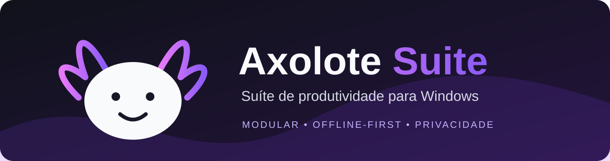

# Axolote Suite v1.2.0

### Ferramentas locais para produtividade, documentos e multimídia no Windows.

  
  
  
  

**Produtividade • Arquivos • PDF • Imagens • Áudio • Vídeo**

---

> [!IMPORTANT]
> Esta atualização organiza o repositório para receber o código-fonte Rust + Iced descrito pelo desenvolvedor. O código-fonte ainda precisa ser enviado para esta estrutura e compilado a partir dela. Não considere build, instalador ou testes aprovados até que sejam executados e registrados.

## 🦎 Sobre o projeto

O **Axolote Suite** é uma aplicação desktop para Windows 10 e Windows 11 que reúne ferramentas de produtividade, edição de imagens, processamento de vídeo e áudio, manipulação de PDF e organização de arquivos.

A proposta é manter o processamento no computador do usuário, com uma interface única e consistente. Depois que os componentes necessários estiverem instalados, as ferramentas locais deverão funcionar sem depender de serviços em nuvem.

## ✨ Funcionalidades descritas para a versão 1.2.0

As funcionalidades abaixo foram descritas no README de desenvolvimento enviado para organizar este repositório. A implementação e os formatos suportados devem ser confirmados com o código-fonte e testes reproduzíveis.

### 🎨 Estúdio e editor de fotos

- Pré-visualização de ajustes antes da exportação.
- Brilho, contraste e saturação.
- Filtros: original, preto e branco, sépia, quente, frio, neon/axolote e negativo.
- Recorte livre e proporções 1:1, 16:9, 9:16 e 4:3.
- Rotação e espelhamento.
- Redimensionamento com filtro Lanczos3.
- Conversão entre PNG, JPG, WebP, BMP e ICO.
- Compressão JPEG com qualidade ajustável.

### 🎬 Estúdio e editor de vídeo

- Pré-visualização de quadro e seleção de trecho.
- Controle de velocidade e ajuste de áudio.
- Proporções de tela 16:9, 9:16 e 1:1.
- Filtros visuais, rotação, espelhamento e controle de volume.
- Conversão entre MP4, MKV, AVI, MOV e WebM.
- Compressão com controle CRF.

### 📄 Central de documentos PDF

- Unir documentos na ordem escolhida.
- Dividir documentos e extrair intervalos de páginas.
- Consultar número de páginas, versão, tamanho e criptografia.

### 📋 Produtividade, arquivos e ZIP

- Bloco de notas com salvamento local.
- Lista de tarefas com filtros e salvamento automático.
- Calculadora com expressões, parênteses, potência, resto e histórico.
- Organizador de pastas com pré-visualização.
- Renomeação em lote com substituição, prefixos, sufixos e numeração.
- Compactação e extração ZIP com proteção contra Zip Slip.

### 💿 Instalação e desinstalação

- Instalador para Windows.
- Criação de atalhos.
- Configuração local do FFmpeg, quando necessário.
- Desinstalador com opção de preservar dados pessoais.

**Nota sobre internet:** o objetivo é que as operações do aplicativo sejam locais. O primeiro instalador poderá precisar de internet para baixar componentes opcionais, como FFmpeg. O aplicativo não deve depender de nuvem para processar os arquivos do usuário.

## 🧱 Tecnologias

| Tecnologia | Uso |
|---|---|
| **Rust** | Linguagem principal |
| **Iced** | Interface desktop |
| **FFmpeg / ffprobe** | Processamento e análise de áudio e vídeo |
| **Cargo** | Dependências e compilação |
| **NSIS**, se adotado | Geração do instalador Windows |

As versões das dependências, recursos habilitados e licenças de distribuição devem ser registradas no projeto. Não distribua binários de terceiros sem verificar os respectivos termos.

## 📂 Organização do repositório

~~~text
AxoloteSuite/
├── .github/                  # Modelos de issues e pull requests
├── assets/
│   └── branding/             # Banner, logotipo e ícone oficiais
├── docs/
│   ├── architecture/
│   ├── modules/
│   ├── security/
│   └── testing/
├── installer/
├── scripts/
├── src/
│   ├── core/
│   ├── shared/
│   └── modules/
├── tests/
├── Cargo.toml
├── Cargo.lock
├── LICENSE
├── README.md
└── .gitignore
~~~

A estrutura será preenchida com os arquivos reais do aplicativo. Não foram criados arquivos Rust vazios para simular implementação.

## 🛠️ Compilar no Windows

Depois de enviar o código-fonte e incluir Cargo.toml na raiz:

~~~powershell
cargo build
cargo build --release
~~~

O executável de produção deverá ser gerado em:

~~~text
target\release\axolote_suite.exe
~~~

O nome final do executável depende da configuração efetiva do pacote Cargo. O processo de instalador deve ser documentado e testado separadamente.

## 🧪 Qualidade e validação

Antes de marcar uma funcionalidade como pronta:

1. Compilar o projeto.
2. Executar os testes automatizados disponíveis.
3. Testar operações com arquivos de exemplo.
4. Verificar cancelamento, erros e permissões.
5. Confirmar que os arquivos originais não foram alterados indevidamente.
6. Documentar formatos suportados e limitações.

Comandos recomendados após o código Rust ser enviado:

~~~powershell
cargo fmt --all -- --check
cargo check --all-targets
cargo test --all-targets
cargo clippy --all-targets -- -D warnings
cargo build --release
~~~

## 🔐 Privacidade e segurança

- Prioridade para processamento local.
- Sem login obrigatório para ferramentas locais.
- Sem telemetria ativada por padrão.
- Sem envio automático de arquivos.
- Validação de entradas e caminhos.
- Preservação dos arquivos originais.
- Proteção contra caminhos maliciosos em arquivos compactados.

Esses itens são requisitos do projeto. Não representam uma auditoria ou certificação de segurança concluída.

## 📚 Documentação

- [Estado atual](docs/ESTADO-ATUAL.md)
- [Visão geral](docs/VISAO-GERAL.md)
- [Módulos](docs/MODULOS-PLANEJADOS.md)
- [Estrutura de pastas](docs/architecture/ESTRUTURA.md)
- [Checklist de testes](docs/testing/CHECKLIST.md)
- [Princípios](docs/PRINCIPIOS.md)
- [Como contribuir](CONTRIBUTING.md)
- [Segurança](SECURITY.md)

## 📦 Versões e downloads

Nenhum instalador deve ser considerado oficial até que seja gerado a partir do código deste repositório e validado. Quando houver uma versão pronta, publique os binários na página **Releases** do GitHub, acompanhados de versão, notas de lançamento e hashes SHA-256.

## 📄 Licença

O README de desenvolvimento informa a intenção de distribuir o projeto sob **MIT OR Apache-2.0**. Os arquivos completos das licenças devem estar presentes na raiz antes da publicação de uma versão distribuível. Confira essa inclusão antes de liberar o código.

---

### Axolote Suite

**Ferramentas úteis. Processamento local. Desenvolvimento verificável.**

