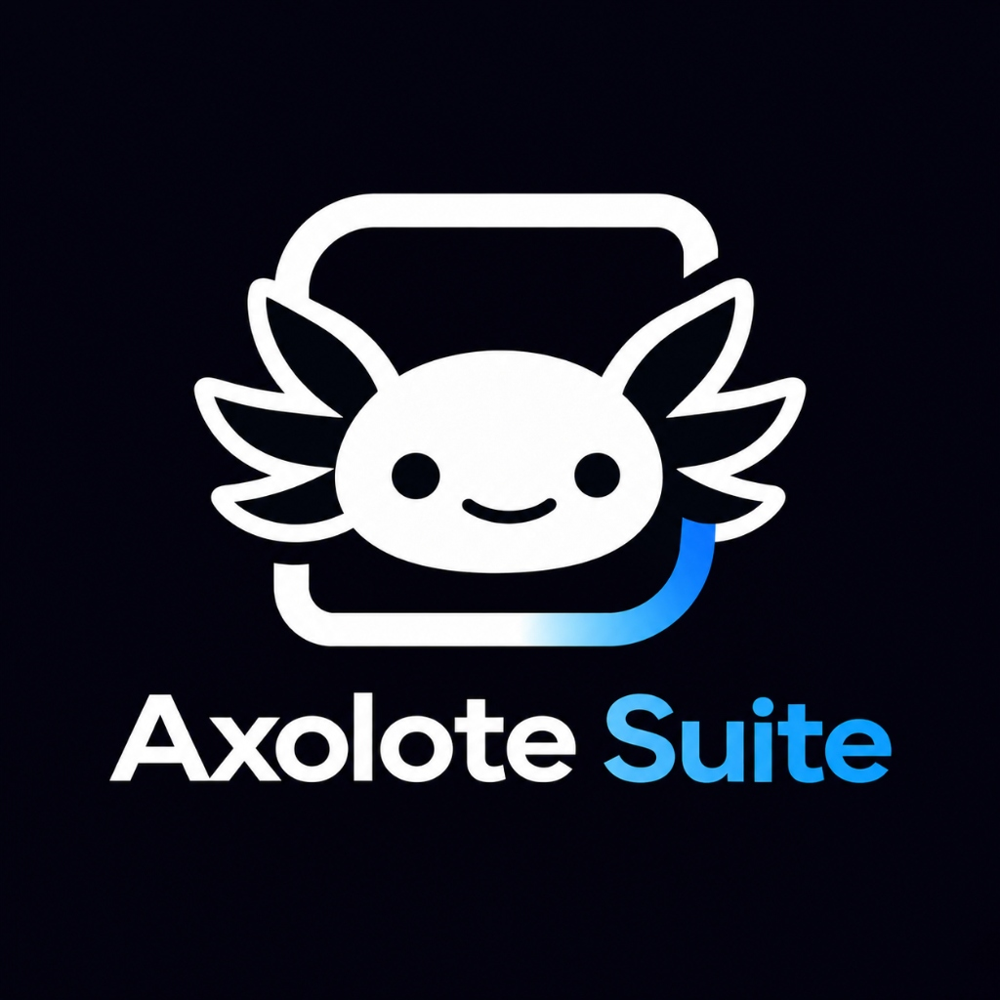

# 🦎 Axolote Suite v1.3.0

<p align="center">
  
</p>

<p align="center">
  <a href="https://github.com/axolotesuite/axolotesuite/releases/download/v1.3.0/axolote_suite.exe">
    
  </a>
  <a href="https://github.com/axolotesuite/axolotesuite/releases/tag/v1.3.0">
    
  </a>
  
</p>

Sua central **100% offline, nativa e modular** para Windows 10 e Windows 11, desenvolvida em **Rust** com **Iced**.

Projetada com a identidade visual oficial do **Axolote Suite** (tema escuro profundo, roxo `#7c3aed` e azul neon `#3b82f6`), **menu lateral animado (60 FPS)**, **design totalmente responsivo** e **guias passo a passo ("💡 Como usar")** em todas as ferramentas.

> 💿 **Download Rápido:** [**Clique aqui para baixar o Instalador Oficial (`axolote_suite.exe`)**](https://github.com/axolotesuite/axolotesuite/releases/download/v1.3.0/axolote_suite.exe) — ao abrir, o instalador configura tudo e **baixa o FFmpeg automaticamente**!

---

## ✨ Principais Funcionalidades

### 🔄 1. Conversor Fácil Universal (1-Clique & Drag and Drop)
- **Destinos Inteligentes por Arquivo**: exibe apenas as conversões reais suportadas para o formato do arquivo selecionado (sem repetir o formato original e sempre oferecendo **`ZIP`**):
  - **Imagens** (`PNG`, `JPG`, `WEBP`, `GIF`, `BMP`, `TIFF`, `ICO`) → demais formatos de imagem + **PDF multi-página** + **ZIP**.
  - **Texto & Documentos** (`TXT`, `MD`, `HTML`, `DOCX`, `PDF`) → conversão entre **TXT, Markdown, HTML, DOCX e PDF** + **ZIP**.
  - **Vídeos** (`MP4`, `MKV`, `WEBM`, `AVI`, `MOV`...) → **MP4, WEBM, MKV, GIF animado, MP3** + **ZIP**.
  - **Áudios** (`MP3`, `WAV`, `FLAC`, `OGG`, `AAC`, `M4A`) → demais formatos de áudio + **ZIP**.
  - **ZIP** (`.zip`) → **EXTRAIR** pasta com proteção contra *Zip-Slip*.
- **Preservação do Original & Escrita Atômica**:
  - O arquivo original é aberto somente para leitura e nunca é alterado ou apagado.
  - Salva ao lado do original com sufixos automáticos `(1)`, `(2)` para nunca sobrescrever silenciosamente.
  - Grava primeiro em arquivo temporário (`.axolote_tmp`) e renomeia ao concluir.
- **Atalho Rápido Global**: acesse pelo menu lateral, arrastando arquivos do Windows Explorer ou pelo atalho **`Ctrl + Alt + N`**.

### 🎨 2. Estúdio de Cores, Paleta de Fotos & Gerador de Senhas
- **Conversor e Harmonia Cromática ao Vivo**: conversão instantânea entre **HEX, RGB, HSL e CMYK** com harmonias Complementar, Análogas e Tríades.
- **Extrator de Paleta de Imagem**: escolha qualquer foto ou logo do PC para extrair automaticamente as **6 cores dominantes** com porcentagem e cópia rápida de HEX.
- **Gerador de Senhas Fortes & UUID v4**: geração 100% local com cálculo de **entropia em bits** e identificadores únicos **UUID v4 (RFC 4122)**.

### 🖼 3. Estúdio & Editor de Fotos (com Preview ao Vivo)
- **Monitor de Pré-visualização em Tempo Real**: ajuste controles e veja o resultado imediatamente na foto antes de exportar.
- **Luz e Cor**: controles deslizantes de **Brilho**, **Contraste** e **Saturação** (`-100` a `+100`).
- **Filtros Instantâneos**: *Original*, *Preto & Branco*, *Sépia*, *Quente*, *Frio*, *Neon/Axolote* e *Negativo*.
- **Enquadramento e Recorte Automático**: `Livre`, `1:1 (Instagram)`, `16:9 (YouTube)`, `9:16 (Reels/TikTok/Shorts)` e `4:3`.
- **Transformações, Redimensionamento e Compressão**: girar `90°`, espelhar, redimensionar com filtro Lanczos3 e comprimir JPEG (`10%–100%`).

### 🎬 4. Estúdio & Editor de Vídeo
- **Monitor de Quadro + Linha do Tempo**: defina o ponto de corte inicial (`De`) e final (`Até`) do clipe.
- **Controle de Velocidade**: `0.5× (Câmera Lenta)`, `1.0×`, `1.25×`, `1.5×` e `2.0× (Time-lapse)` com ajuste automático de áudio (`atempo`).
- **Formato de Tela (Canvas)**: `Original`, `16:9 YouTube (1920×1080)`, `9:16 TikTok/Reels (1080×1920)` e `1:1 Feed (1080×1080)`.
- **Filtros de Cinema & Áudio**: estilos *Vibrante*, *P&B*, *Retrô* e *Cinema*, rotação/espelhamento, modo mudo (`Mute`) e amplificação de volume até `200%`.
- **Conversor & Compressor CRF**: converta entre **MP4, MKV, AVI, MOV e WebM** ou comprima com controle **CRF (`18–36`)**.

### 📄 5. Central de Documentos PDF, Produtividade, Arquivos e ZIP
- **Unir e Dividir PDFs**: combine vários documentos na ordem que quiser (`↑ / ↓`), extraia páginas ou consulte metadados.
- **Bloco de Notas (`.txt`), Lista de Tarefas e Calculadora Científica Expressa**: com parênteses, potência (`^`), porcentagem (`%`) e histórico clicável.
- **Organizador Inteligente de Pastas & Renomeação em Lote**: pré-visualização instantânea antes de aplicar.
- **Compactador e Extrator ZIP**: proteção contra *Zip-Slip* e compactação recursiva de pastas completas.

### 💿 6. Instalador Principal (Setup) com Download Automático do FFmpeg & Desinstalador
- **Tela Principal de Setup no Primeiro Uso**: instala no PC, **baixa e configura automaticamente o FFmpeg**, cria atalhos na **Área de Trabalho** e no **Menu Iniciar** com o ícone oficial e registra no Windows sem exigir Administrador.

---

## 📂 Estrutura do Projeto

```text
Axolote_Suite/
├── assets/                  # Logos e ícones oficiais do Axolote Suite (.ico, .png, .jpg)
├── src/
│   ├── main.rs              # Ponto de entrada com ícone nativo da janela
│   ├── lib.rs               # Biblioteca raiz
│   ├── app.rs               # Shell principal, barra lateral animada, busca e painel Início
│   ├── core/                # Configurações, histórico, fila assíncrona, caminhos e download FFmpeg
│   ├── shared/              # Tema visual (escuro/claro), componentes responsivos e logos
│   └── modules/             # Módulos (quick_convert, devtools, productivity, images, video,
│                            #          audio, pdf, zip, batch_rename, installer, queue, history, settings)
├── Cargo.toml
├── LICENSE
└── README.md
```

---

## 🚀 Como Compilar

```powershell
# Gerar o executável final de produção (otimizado e portátil)
cargo build --release
```

O executável final pronto para distribuição fica em:
```text
target\release\axolote_suite.exe
```

## 📄 Licença

Distribuído sob licença **MIT OR Apache-2.0** (veja [LICENSE](LICENSE)).
