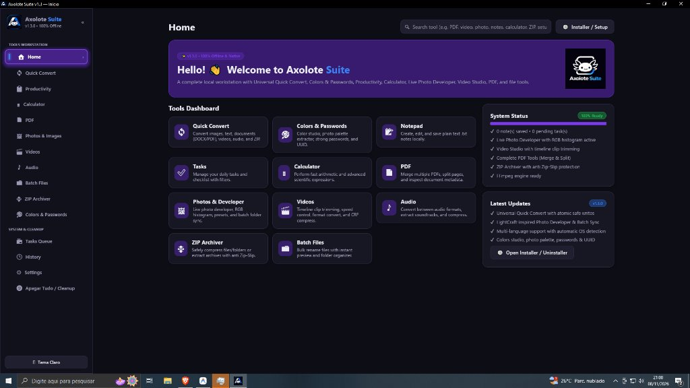

<p align="center">
  <a href="https://axolotesuite.github.io/axolotesuite/">
    
  </a>
</p>

<h1 align="center">Axolote Suite</h1>

<p align="center">
  <b>Sua central de ferramentas offline para Windows, escrita do zero em Rust puro.</b><br>
  Conversor universal, editor de fotos, editor de vídeo, áudio, PDF, ZIP, cores e produtividade,<br>
  num app nativo, leve e sem anúncios. Código aberto, 100% offline e seu.
</p>

<p align="center">
  
  
  
  
  <br>
  <a href="https://github.com/axolotesuite/axolotesuite/actions/workflows/ci.yml"></a>
  <a href="https://www.virustotal.com/gui/search/86dfba6f0aa76a07ecc77604fb540fa7cfab0b969851bdac9403293dc5277a68"></a>
  <a href="https://github.com/axolotesuite/axolotesuite/stargazers"></a>
</p>

<p align="center">
  <a href="https://github.com/axolotesuite/axolotesuite/releases/download/v1.4.2/Axolote_Setup.exe"></a>
  <a href="https://github.com/axolotesuite/axolotesuite/releases/download/v1.4.2/axolote_suite.exe"></a>
</p>

<p align="center">
  <a href="https://axolotesuite.github.io/axolotesuite/"><b>Site oficial</b></a> ·
  <a href="https://github.com/axolotesuite/axolotesuite/releases">Todas as versões</a> ·
  <a href="CHANGELOG.md">Novidades</a> ·
  <a href="ROADMAP.md">Roadmap</a>
</p>

<br>

<p align="center">
  
  <br>
  <sub>Tela inicial real do Axolote Suite rodando nativamente no Windows com detecção automática de idioma e Central de 12 Ferramentas.</sub>
</p>

> [!NOTE]
> **O Axolote Suite é feito por e para a comunidade.** Achou um bug, tem uma ideia ou quer ajudar no código?
> **[Abra uma issue](https://github.com/axolotesuite/axolotesuite/issues/new/choose)** ou leia o **[guia de contribuição](CONTRIBUTING.md)**.

<p align="center">
  <a href="#funcionalidades">Funcionalidades</a> ·
  <a href="#tudo-na-caixa">Tudo na caixa</a> ·
  <a href="#por-dentro">Por dentro</a> ·
  <a href="#começar">Começar</a> ·
  <a href="#downloads">Downloads</a> ·
  <a href="#segurança">Segurança</a> ·
  <a href="#licença-e-créditos">Licença</a>
</p>

<br>

<table>
  <tr>
    <td width="25%" valign="top">
      <h3>📴 100% offline</h3>
      Nada vai para a nuvem. Seus arquivos são processados no seu PC, sem conta, sem rastreamento e sem anúncios.
    </td>
    <td width="25%" valign="top">
      <h3>⚡ Nativo e rápido</h3>
      Escrito em Rust com a interface Iced. Sem Electron, sem navegador embutido: um único <code>.exe</code> de ~13 MB.
    </td>
    <td width="25%" valign="top">
      <h3>🛡️ Seu arquivo é sagrado</h3>
      O original nunca é alterado. Tudo é salvo ao lado, com <code>(1)</code>, <code>(2)</code>, gravação atômica e nada sobrescrito sem você pedir.
    </td>
    <td width="25%" valign="top">
      <h3>🧭 Fácil de verdade</h3>
      Cada ferramenta tem um guia "💡 Como usar". Arraste arquivos do Explorer ou use <code>Ctrl + Alt + N</code> de qualquer lugar.
    </td>
  </tr>
</table>

<br>

## Funcionalidades

<table>
  <tr>
    <td width="50%" valign="top">
      <h3>🔄 Conversor Fácil Universal</h3>
      Escolha o arquivo e clique no formato. O Axolote mostra <b>só as conversões que fazem sentido</b> para aquele arquivo:
      <br><br>
      <b>Imagens</b> PNG, JPG, WEBP, GIF, BMP, TIFF e ICO, entre si, para PDF ou ZIP.<br>
      <b>Documentos</b> TXT, MD, HTML, DOCX e PDF.<br>
      <b>Vídeos</b> para MP4, WEBM, MKV, GIF animado ou MP3.<br>
      <b>Áudios</b> MP3, WAV, FLAC, OGG, AAC e M4A.<br>
      <b>ZIP</b> extraído com proteção contra <i>Zip-Slip</i>.
    </td>
    <td width="50%" valign="top">
      <h3>🖼️ Estúdio de Fotos com preview ao vivo</h3>
      Brilho, contraste e saturação de <code>-100</code> a <code>+100</code>, vistos na hora no monitor de pré-visualização.
      <br><br>
      Filtros <i>P&amp;B</i>, <i>Sépia</i>, <i>Quente</i>, <i>Frio</i>, <i>Neon</i> e <i>Negativo</i>; recortes prontos <code>1:1</code>, <code>16:9</code>, <code>9:16</code> e <code>4:3</code>; girar, espelhar, redimensionar com Lanczos3 e comprimir JPEG de 10% a 100%.
    </td>
  </tr>
  <tr>
    <td width="50%" valign="top">
      <h3>🎬 Editor de Vídeo</h3>
      Corte na linha do tempo (<code>De</code> → <code>Até</code>), velocidade de <code>0.5×</code> a <code>2.0×</code> com áudio ajustado automaticamente e formatos de tela para YouTube (16:9), Reels/Shorts (9:16) e Feed (1:1).
      <br><br>
      Filtros <i>Vibrante</i>, <i>P&amp;B</i>, <i>Retrô</i> e <i>Cinema</i>, modo mudo, volume até 200% e compressão CRF de 18 a 36. O FFmpeg é baixado sozinho no primeiro uso.
    </td>
    <td width="50%" valign="top">
      <h3>🎨 Cores &amp; Senhas</h3>
      Conversão instantânea entre <b>HEX, RGB, HSL e CMYK</b> com harmonias complementar, análogas e tríade.
      <br><br>
      Extraia as <b>6 cores dominantes</b> de qualquer foto ou logo, gere <b>senhas fortes</b> com cálculo de entropia e identificadores <b>UUID v4</b>, tudo localmente.
    </td>
  </tr>
  <tr>
    <td width="50%" valign="top">
      <h3>📄 Central de PDF</h3>
      Una vários PDFs na ordem que quiser (<code>↑</code> / <code>↓</code>), divida por páginas ou intervalos e consulte os metadados do documento em segundos.
    </td>
    <td width="50%" valign="top">
      <h3>🗂️ Produtividade &amp; Arquivos</h3>
      Bloco de notas, lista de tarefas, calculadora científica com histórico, organizador de pastas, renomeação em lote com pré-visualização e compactador ZIP de pastas inteiras.
    </td>
  </tr>
</table>

<br>

## Tudo na caixa

<table>
  <tr>
    <td width="33%" valign="top">
      <h4>🧰 13 módulos</h4>
      Conversor Fácil · Fotos · Vídeo · Áudio · PDF · ZIP · Cores &amp; Senhas · Produtividade · Renomeação em lote · Fila de operações · Histórico · Configurações · Instalador
    </td>
    <td width="33%" valign="top">
      <h4>🗂️ Formatos</h4>
      PNG · JPG · WEBP · GIF · BMP · TIFF · ICO · PDF · TXT · MD · HTML · DOCX · MP4 · WEBM · MKV · AVI · MOV · MP3 · WAV · FLAC · OGG · AAC · M4A · ZIP
    </td>
    <td width="33%" valign="top">
      <h4>🪄 O essencial do dia a dia</h4>
      Tema escuro e claro · menu lateral animado · busca de ferramentas · fila assíncrona · histórico · arrastar e soltar · atalho global <code>Ctrl + Alt + N</code> · instalador sem precisar de administrador
    </td>
  </tr>
</table>

<br>

## Por dentro

- **Rust do começo ao fim:** interface nativa com [Iced](https://github.com/iced-rs/iced), imagens com [`image`](https://crates.io/crates/image), PDF com [`lopdf`](https://crates.io/crates/lopdf) e ZIP com [`zip`](https://crates.io/crates/zip).
- **Modular:** cada ferramenta é um módulo independente em `src/modules/` com `mod.rs` (estado), `view.rs` (interface) e `service.rs` (lógica pura e testável).
- **Seguro com arquivos:** o original é aberto só para leitura, a saída vai primeiro para um `.axolote_tmp` e só depois é renomeada, e a extração de ZIP é blindada contra *Zip-Slip*.
- **Leve:** um único executável, sem runtime, com 0% de CPU quando está parado.

```text
Axolote_Suite/
├── assets/          # logos e ícones oficiais
├── docs/images/     # imagens do README
├── src/
│   ├── main.rs      # ponto de entrada
│   ├── app.rs       # janela principal, menu lateral, busca e Início
│   ├── core/        # configurações, histórico, fila, caminhos e FFmpeg
│   ├── shared/      # tema, componentes e marca
│   └── modules/     # uma pasta por ferramenta
└── .github/         # CI, templates de issue e PR, Dependabot
```

## Começar

```powershell
git clone https://github.com/axolotesuite/axolotesuite
cd axolotesuite
cargo run --release      # abre o app
cargo test               # roda os testes
```

O executável final fica em `target\release\axolote_suite.exe`.

Novos contribuidores e agentes de IA: comecem por [`AGENTS.md`](AGENTS.md) e [`CONTRIBUTING.md`](CONTRIBUTING.md).

> [!IMPORTANT]
> **Status:** o Axolote Suite está em desenvolvimento ativo. As ferramentas principais funcionam, mas ainda há arestas para aparar. Se algo quebrar, [abra uma issue](https://github.com/axolotesuite/axolotesuite/issues/new/choose) com sua versão do Windows, o arquivo que usou (se puder) e um print. O que vem por aí está no [roadmap](ROADMAP.md).

## Downloads

**Primeira vez?** Baixe direto pelo [site oficial](https://axolotesuite.github.io/axolotesuite/) ou pelos botões abaixo.

| Sistema | Pacote | Formato | Observações |
|---|---|---|---|
| Windows 10 / 11 (x64) | [**`Axolote_Setup.exe`**](https://github.com/axolotesuite/axolotesuite/releases/download/v1.4.2/Axolote_Setup.exe) | Instalador Oficial | **Recomendado**: instalador e desinstalador completo em 19 idiomas |
| Windows 10 / 11 (x64) | [**`axolote_suite-portable.zip`**](https://github.com/axolotesuite/axolotesuite/releases/download/v1.4.2/axolote_suite-portable.zip) | ZIP Portátil | Executável + licenças prontos para extrair e rodar |
| Windows 10 / 11 (x64) | [**`axolote_suite.exe`**](https://github.com/axolotesuite/axolotesuite/releases/download/v1.4.2/axolote_suite.exe) | Executável Portátil | Executável direto sem instalação |
| Todos | [**`SHA256SUMS.txt`**](https://github.com/axolotesuite/axolotesuite/releases/download/v1.4.2/SHA256SUMS.txt) | Assinaturas | Hashes criptográficos oficiais para conferência |

Versões anteriores e notas de cada lançamento ficam em [Releases](https://github.com/axolotesuite/axolotesuite/releases).

## Segurança

**Por que o Windows ou o navegador avisa ao baixar o `.exe` direto?** Certificados corporativos de assinatura de código (*EV Code Signing*) da Microsoft custam mais de US$ 400 por ano. Como o Axolote Suite é 100% gratuito e de código aberto, navegadores emitem um alerta preventivo de "arquivo pouco baixado".

> [!TIP]
> Baixar o arquivo **`axolote_suite-portable.zip`** evita o aviso na grande maioria dos navegadores, bastando extrair e rodar.

| Onde aparece (no .exe) | O que fazer |
|---|---|
| **Navegador** (Chrome / Edge) | Clique nos três pontinhos `⋯` do download → **Manter** → **Manter assim mesmo** |
| **Windows SmartScreen** | Clique em **Mais informações** → **Executar assim mesmo** |

Confira você mesmo se os arquivos são os oficiais usando o hash SHA-256 e o arquivo `SHA256SUMS.txt` gerado automaticamente em cada release:

```powershell
Get-FileHash .\axolote_suite.exe -Algorithm SHA256
Get-FileHash .\Axolote_Setup.exe -Algorithm SHA256
```

Compare com o arquivo de assinaturas oficial publicado em [Releases](https://github.com/axolotesuite/axolotesuite/releases) e consulte o hash no [VirusTotal](https://www.virustotal.com/). Para relatar uma vulnerabilidade, veja a [política de segurança](SECURITY.md).

<br>

<h3 align="center">Vamos construir junto</h3>

<p align="center">
  Usa o Axolote no dia a dia? Conta pra gente o que funciona, o que quebrou e o que você queria que ele fizesse.<br>
  Toda issue, ideia e Pull Request é bem-vinda, não importa o seu nível.
</p>

<p align="center">
  <a href="https://github.com/axolotesuite/axolotesuite/issues/new/choose"><b>Abrir uma issue</b></a> ·
  <a href="CONTRIBUTING.md">Contribuir</a> ·
  <a href="https://axolotesuite.github.io/axolotesuite/">Site oficial</a>
</p>

---

## Licença e créditos

O Axolote Suite é licenciado sob [MIT](LICENSE-MIT) ou [Apache-2.0](LICENSE-APACHE), à sua escolha.
Copyright (c) 2026 Axolote Suite e contribuidores. Os avisos obrigatórios estão em [NOTICE](NOTICE).

O nome Axolote Suite, os logos e o mascote em [`assets/`](assets/) pertencem ao projeto. Forks e versões modificadas devem usar outro nome e outros logos.

<sub>A organização deste README e do repositório foi inspirada nos <a href="https://github.com/storytold/photocraft">Crafting Apps</a> do time ArtCraft. O Axolote Suite é um projeto independente, sem afiliação com eles, e não usa código deles.</sub>

<p align="center">
  <br>
  <sub>Feito pela comunidade do Axolote Suite.</sub>
</p>

## Histórico de estrelas

[](https://www.star-history.com/#axolotesuite/axolotesuite&Date)
