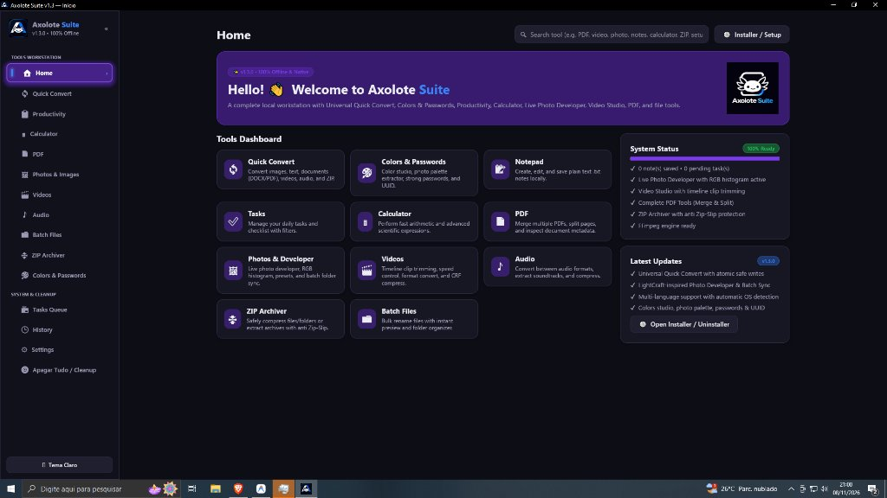

# 🚀 Kit Oficial de Divulgação — Axolote Suite v1.3.0

> Este documento contém os textos prontos para você copiar e colar em cada uma das plataformas de tecnologia mais influentes do mundo. Todos os links, tags e formatações já estão configurados para gerar máximo engajamento, downloads e estrelas (stars) no GitHub!

---

## 1. 📝 Artigo Completo para o [DEV.to](https://dev.to/new)

**Título:**
`I built a 100% offline, native Windows creative workstation in pure Rust (and it's completely open source)`

**Tags:**
`rust`, `opensource`, `windows`, `productivity`

**Capa / Cover Image (Opcional):**
Utilize a screenshot real: `https://raw.githubusercontent.com/axolotesuite/axolotesuite/main/assets/app_screenshot.jpg`

### Conteúdo do Post (Copie e Cole no DEV.to):

```markdown
---
title: I built a 100% offline, native Windows creative workstation in pure Rust (and it's completely open-source)
published: true
tags: rust, opensource, windows, productivity
cover_image: https://raw.githubusercontent.com/axolotesuite/axolotesuite/main/assets/app_screenshot.jpg
canonical_url: https://axolotesuite.github.io/axolotesuite/
---

Tired of uploading sensitive photos and documents to ad-ridden web converters with daily artificial limits? Annoyed by heavy, sluggish Electron desktop apps that hog 800 MB of RAM just to trim a video or merge two PDFs?

I decided to solve this once and for all: I built **Axolote Suite**, a complete, 100% offline creative and utility suite written from scratch in pure **Rust + Iced**.



* 🌐 **Live Website:** [axolotesuite.github.io/axolotesuite](https://axolotesuite.github.io/axolotesuite/)
* 🐙 **GitHub Repository:** [github.com/axolotesuite/axolotesuite](https://github.com/axolotesuite/axolotesuite)
* 📦 **Download Latest Release (v1.3.0):** [GitHub Releases](https://github.com/axolotesuite/axolotesuite/releases/tag/v1.3.0)

---

## 💡 Why Rust? (Zero Electron, Native 60 FPS)

Most modern desktop utilities are Electron wrappers around web apps. While convenient for rapid prototyping, they consume gigabytes of memory, start slowly, and compromise privacy.

Rust gave us:
1. **Blazing Speed & Low Footprint:** Cold boot in under 0.2s, buttery-smooth 60 FPS UI powered by `Iced 0.12` and GPU-accelerated rendering.
2. **Absolute Memory Safety & Privacy:** 100% offline. Zero telemetry, zero cloud tracking, zero network requests for conversions.
3. **Atomic File Safety:** Original files are strictly opened in read-only mode. All conversions write to a hidden `.tmp` file and rename atomically, so nothing is ever overwritten or lost.

---

## 🛠️ What's Inside the Box? (12 Native Modules)

Axolote Suite isn't just one utility; it packs 12 native modules into a single lightweight binary:

### 1. ⚡ Universal Quick Convert
One-click drag-and-drop conversions across categories:
- **Images:** PNG, JPG, WebP, BMP, ICO.
- **Documents:** TXT ↔ Markdown ↔ HTML ↔ DOCX ↔ PDF.
- **Video & Audio:** MP4, WebM, MKV, GIF, MP3, WAV, FLAC, OGG.
- **Archives:** Safe ZIP extraction and creation.

### 2. 📸 Live Photo Developer & Studio
Inspired by professional photo workflows:
- Exposure stops (-3.0 to +3.0 EV), highlights, shadows, white balance, vibrance, sharpness, and film grain.
- **Live 256-bin RGB Histogram** updating smoothly in real-time.
- One-click cinema presets (Film Noir, Golden Hour, Cyber Neon, Vintage Warm).
- Batch folder synchronization to develop an entire photoshoot in seconds.

### 3. 🎬 Timeline Video Editor & Compressor
- Fast clip trimming with millisecond precision.
- Canvas aspect ratio formatting (`16:9`, `9:16` vertical, `1:1` square).
- Speed control (`0.5×` slow-mo to `2.0×` fast-forward).
- Integrated CRF-based video compressor to drastically reduce file size without visible quality loss.
- Automatic self-hosted FFmpeg engine provisioning on first run.

### 4. 🎨 Colors & Passwords Studio
- Live bi-directional converter across `HEX`, `RGB`, `HSL`, and `CMYK`.
- **Photo Palette Extractor:** extracts the 6 dominant chromatic colors from any image dropped into the app.
- Cryptographically secure Password Generator with real-time bit entropy calculation and UUID v4 generation.

### 5. 📑 Complete PDF Hub & Safe Archiver
- Merge multiple PDF documents in custom sequence.
- Split single pages or custom intervals.
- Built-in ZIP protection against Zip-Slip path traversal attacks.

### 6. 🌐 Automatic OS Language Detection
Axolote Suite automatically probes your Windows OS locale (`sys_locale`). If your machine is in English, it greets you in English; if it's in Portuguese, it launches in Portuguese. An interactive switcher in Settings also allows manual switching at any time.

---

## 🚀 Try It Out (100% Free & Open Source)

Axolote Suite is dual-licensed under **MIT / Apache-2.0**.

- If you don't want browser warnings: grab the **portable `.zip` package** from [GitHub Releases](https://github.com/axolotesuite/axolotesuite/releases/tag/v1.3.0). Unzip and run!
- Prefer an installer? Grab `axolote_suite.exe` (SHA-256 audited on VirusTotal).

If you find this project useful or believe in native desktop software over bloated web wrappers, please **give the repository a ⭐ on GitHub**!

👉 **[Star Axolote Suite on GitHub](https://github.com/axolotesuite/axolotesuite)**

Feedback, feature requests, and pull requests are warmly welcomed!
```

---

## 2. 👾 Reddit Posts

### Post 1: para o `r/rust`

**Subreddit:** [reddit.com/r/rust](https://www.reddit.com/r/rust/submit)  
**Título:**  
`Axolote Suite: An open-source, 100% offline Windows creative workstation written in pure Rust + Iced`

**Flair:** `Project` ou `Release`

**Texto:**
```markdown
Hey everyone! 👋

I wanted to share **Axolote Suite**, an open-source, 100% offline creative and utility suite for Windows 10/11 written from scratch in pure Rust using `iced 0.12`.

Like many here, I was frustrated with having to upload files to ad-filled web converters with rate limits, or downloading massive 500MB Electron apps just to batch convert images or trim a video clip.

Axolote Suite bundles 12 native modules into a single fast binary:
- **Universal Quick Convert:** 1-click conversions for images, documents (TXT/MD/HTML/DOCX/PDF), video/audio, and ZIP with strict atomic write safety.
- **Photo Developer:** Real-time exposure, highlights, shadows, sharpness, cinema presets, live 256-bin RGB histogram, and batch folder sync.
- **Video Editor & Compressor:** Timeline trimming, speed control (0.5x to 2x), 9:16/16:9 formats, and CRF compression via auto-provisioned FFmpeg.
- **Colors & Passwords:** Dominant palette extractor from photos, HEX/RGB/HSL/CMYK conversion, bit entropy password generator & UUID v4.
- **PDF & ZIP:** Merge/split PDFs and extract archives with automatic Zip-Slip traversal defense.
- **Multi-language:** Automatically detects your Windows OS locale (English & Portuguese).

The whole app runs cold in ~0.2s with zero telemetry or network calls.

- GitHub: https://github.com/axolotesuite/axolotesuite
- Website: https://axolotesuite.github.io/axolotesuite/
- Releases: https://github.com/axolotesuite/axolotesuite/releases/tag/v1.3.0

Feedback and contributions are super welcome! Let me know what you think.
```

---

### Post 2: para o `r/SideProject` ou `r/opensource`

**Subreddit:** [reddit.com/r/SideProject](https://www.reddit.com/r/SideProject/submit) / [reddit.com/r/opensource](https://www.reddit.com/r/opensource/submit)  
**Título:**  
`I got tired of ad-filled file conversion websites, so I built a 100% offline, native Windows app in Rust (Axolote Suite)`

**Texto:**
```markdown
Every time I needed to convert a WebP to PNG, merge two PDFs, or trim a quick video clip, I either had to:
1. Upload personal files to shady websites full of popups.
2. Download a 400MB Electron wrapper that drained RAM.

So I spent the last few weeks building **Axolote Suite** — an open-source, 100% offline workstation written natively in Rust for Windows 10 and 11.

It has:
- One-click format conversions (images, docs, audio, video, zip).
- Lightroom-inspired photo developer with live RGB histogram.
- Timeline video editor and CRF compressor.
- Color palette extractor and secure password generator.
- Automatic OS language detection (English & Portuguese).
- Zero telemetry, zero cloud dependencies.

Everything is completely free and open-source (MIT/Apache 2.0).

Check it out on GitHub: https://github.com/axolotesuite/axolotesuite
Official Website: https://axolotesuite.github.io/axolotesuite/

Would love your thoughts and feedback!
```

---

## 3. 🌐 Hacker News (Show HN)

**Link:** [news.ycombinator.com/submit](https://news.ycombinator.com/submit)  
**Título:**  
`Show HN: Axolote Suite – Offline Windows creative workstation in Rust + Iced`

**URL:** `https://github.com/axolotesuite/axolotesuite`

---

## 4. 🐦 Post para o X (Twitter / Bluesky / Threads)

```text
🚀 Introducing Axolote Suite v1.3.0!

A 100% offline, native Windows creative workstation built from scratch in pure Rust + Iced. 🦀

✨ 1-Click Universal Converter (Images, Docs, Video, Audio, ZIP)
📸 Live Photo Developer with RGB Histogram
🎬 Timeline Video Editor & Compressor
🎨 Color Studio & Password Generator
🔒 Zero Telemetry. 100% Free & Open Source.

👉 Try it: https://axolotesuite.github.io/axolotesuite/
⭐ Star on GitHub: https://github.com/axolotesuite/axolotesuite

#rustlang #opensource #windows #productivity
```

---

## 5. 💼 Post para o LinkedIn (Português & Inglês)

```text
Cansado de subir documentos e fotos confidenciais em sites de conversão cheios de anúncios e limitações? Ou de usar aplicativos pesados em Electron que consomem toda a sua memória RAM?

Desenvolvi e lancei o Axolote Suite v1.3.0: uma central completa de ferramentas utilitárias e criativas, 100% offline, nativa para Windows e escrita do zero em Rust puro + Iced! 🦎🦀

Principais recursos:
⚡ Conversor Universal em 1 clique (Imagens, PDF, DOCX, Markdown, Vídeos, Áudio e ZIP)
📸 Revelador de Fotos ao vivo com histograma RGB e presets de cinema
🎬 Editor e Compressor de Vídeo com corte na linha do tempo
🎨 Estúdio de Cores (conversão HEX/RGB/HSL/CMYK e paleta de fotos)
🛡️ Privacidade absoluta: zero telemetria, zero nuvem, escrita atômica sem sobrescrever arquivos originais
🌐 Detecção automática do idioma do computador (Inglês e Português)

O projeto é 100% gratuito e de Código Aberto (Open Source):
🔗 Site Oficial: https://axolotesuite.github.io/axolotesuite/
⭐ Repositório no GitHub: https://github.com/axolotesuite/axolotesuite

Feedback da comunidade de tecnologia e contribuições no código são muito bem-vindos!

#Rust #OpenSource #DesenvolvimentoDeSoftware #Windows #Produtividade #Tech
```
